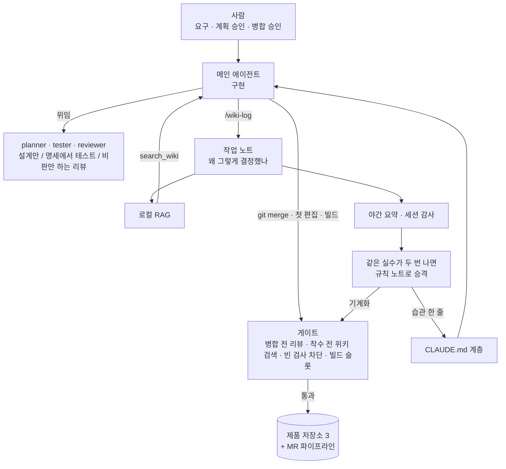

# AI 코딩 에이전트 하네스 구축기

Java 백엔드 개발자입니다. 작은 팀에서 개발을 혼자 맡아, Claude Code로 엔터프라이즈 보안 솔루션 3종을 만들었습니다(2026-06 ~ 2026-11).
그 과정에서 AI 에이전트 하네스를 스스로 공부해 만들고 운영한 내용을 담았습니다. 근거는 git 이력과 작업 기록에서 뽑아 제시하겠습니다.

## 요약

| | |
|---|---|
| **역할** | 제품 3종의 설계·구현·테스트·운영 문서를 맡았습니다. 기획과 사용 테스트 피드백은 개발자가 아닌 동료들이 맡았습니다 |
| **계기** | 에이전트가 만드는 코드를 혼자 다 읽을 수 없었습니다. ["Fighting slop with slop"](https://www.youtube.com/watch?v=bKT2wOec_rg) 강연을 보고, 사람의 리뷰를 기계 검사로 바꾸는 방식을 적용했습니다([부록 A](docs/appendix-a-origin.md)) |
| **제품** | IAM 플랫폼(SCIM 2.0 기반 마이크로서비스), 유출 계정 탐지 모듈, MFA 제품. 모두 고객망 설치형입니다 |
| **방법** | 역할 분리(설계·구현·테스트·리뷰), 병합 전 게이트, 로컬 RAG 위키, 매일 도는 세션 감사. 두 번 반복된 실수는 규칙으로 만들고, 그래도 반복되면 기계로 막았습니다 |

## 실패가 장치로 바뀐 사례

| # | 문제 | 바꾼 것 |
|---|---|---|
| 1 | 공유 개발 DB에 적용한 마이그레이션이 다른 워크트리의 기동을 깨뜨렸다 | 기동 직전에 DB 적용 이력과 모든 워크트리의 마이그레이션 파일을 대조하는 게이트 |
| 2 | 캐시에서 복원된 테스트를 "통과"로 보고했다 | 보고 규칙, CI의 캐시 차단, 패턴에 맞는 테스트가 0건이면 실패하는 빌드 가드 |
| 3 | 공유 저장소에서 `git add -A` 가 다른 세션의 작업까지 커밋에 담았다 | 경로를 지정해 바로 커밋하는 규칙을 자동 로드 문서에 올림, 노트 저장 즉시 커밋 |
| 4 | 리뷰 없이 통합 브랜치에 병합했다 | 세션 기록 감사 → 병합 직전에 막는 전역 게이트 |
| 5 | 동시 빌드로 개발 머신 메모리가 바닥났다 | 머신 전체 빌드 상한과 원격 VM 분산 |

증상·원인·효과는 [01 사례](docs/01-case-studies.md)에 있습니다. 효과를 아직 재지 못한 것은 그렇다고 적었습니다.

## 전체 구조



규모는 137일, 병합을 뺀 커밋 6,002개, 규칙 노트 90개(참고용 1개 별도), 작업 노트 1,065건입니다. 코드 줄 수와 차트, 각 수치의 정의는 [06 지표](docs/06-metrics.md)에 있습니다.

## 문서

| 문서 | 내용 |
|---|---|
| [01 사례](docs/01-case-studies.md) | 실패가 규칙·장치로 바뀐 사례 5개 |
| [02 하네스](docs/02-harness.md) | CLAUDE.md 계층, 역할 분리, 기능·버그 파이프라인, 게이트, 동시 빌드 상한, MR 파이프라인 |
| [03 지식 루프](docs/03-knowledge-loop.md) | 노트 캡처 → 로컬 RAG 검색 → 야간 요약 → 세션 감사 → 규칙 승격, 용어 사전 |
| [04 따라 만들기](docs/04-getting-started.md) | 혼자 시작한다면 무엇부터 만들지, 환경, [예시 정의 파일](examples/) |
| [05 배운 것](docs/05-lessons.md) | 배운 것, 한계, 지금도 사람이 하는 일 |
| [06 지표](docs/06-metrics.md) | git 집계 차트와 각 지표의 정의·한계 |
| [부록 A 출발점](docs/appendix-a-origin.md) | 계기가 된 강연과 그 내용을 대조·적용한 과정 |
| [용어집](docs/glossary.md) | 문서에 나오는 작업 용어 풀이 |
| [data](data/README.md) | 수치마다 붙인 집계 정의와 재현 명령 |

## 재현

```bash
python3 scripts/collect.py   # 저장소 설정(라벨|경로|ref)을 읽어 data/*.csv 생성
python3 scripts/charts.py    # data/*.csv → assets/charts/*-{light,dark}.svg
./scripts/sanitize-check.sh  # 공개 전 금칙어 전수 검사(목록은 로컬 파일)
```

git 집계 수치는 이 스크립트로 다시 뽑을 수 있습니다. `hits` 나 메모리 실측값처럼 작업 노트에서 온 수는 그 노트가 출처입니다. 원본 저장소는 비공개라, 외부에서는 스크립트와 정의만 볼 수 있습니다.
