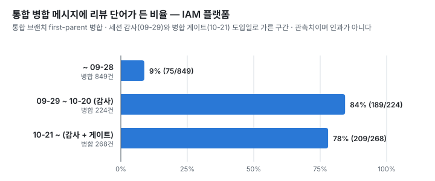
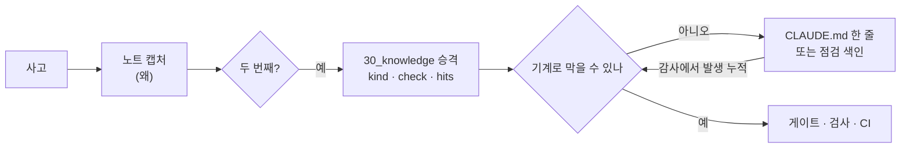

# 01. 사례 — 실패가 규칙과 장치로 바뀐 과정

각 사례는 증상 → 원인 → 규칙/장치 → 효과 순서로 적었습니다.
- 날짜와 발생 기록은 지식 저장소 노트의 「재현 이력」과 `hits` 에서 옮겼습니다.
- `hits` 는 같은 실수가 발생한 횟수의 하한이고, 승격 전의 첫 발생도 포함합니다.

| # | 사례 | 처음 기록 | 발생 기록(하한) | 지금의 장치 |
|---|---|---|---:|---|
| 1 | 공유 개발 DB에 적용된 마이그레이션이 다른 워크트리의 기동을 깨뜨렸다 | 2026-07-21 | 6 | 단독 커밋 규칙 → 기동 전 대조 → 기동 게이트 |
| 2 | 캐시에서 복원된 결과를 "테스트 통과"로 보고했다 | 2026-08-18 | 7 | `--rerun` 규칙, CI 캐시 차단, 0건 필터 가드 |
| 3 | 공유 저장소에서 `git add -A` 가 다른 세션의 작업을 쓸어 담았다 | 2026-07-21 | — | 자동 로드 문서의 금지 규칙, 저장 즉시 커밋 |
| 4 | 리뷰 없이 통합 브랜치에 병합했다 | 2026-08-28 승격 | 35 | 세션 감사 → 전역 병합 게이트 |
| 5 | 동시 빌드로 개발 머신 메모리가 바닥났다 | 2026-11-05 | — | 머신 전체 빌드 슬롯 + 원격 VM 분산 |

---

## 1. 공유 개발 DB에 적용된 마이그레이션이 다른 워크트리의 기동을 깨뜨렸다

#### 증상

여러 세션이 워크트리를 나눠 쓰면서 개발 DB는 하나를 공유했습니다. 한 세션이 자기 브랜치의 마이그레이션을 공유 DB에 적용하면, 그 파일이 없는 다른 워크트리는 마이그레이션 검증에서 기동이 멈췄습니다(`Detected applied migration not resolved locally`).

| 날짜 | 기록 |
|---|---|
| 2026-07-21 | 처음 발생. 파일이 없는 워크트리가 전부 기동 불가 |
| 2026-08-12 | 같은 예외 |
| 2026-09-01 | 워크트리 3개가 같은 예외 |
| 2026-09-22 | 다른 제품 저장소에서 빈 번호를 뒤늦게 병합하자, 더 높은 번호만 든 트리 6개가 노출됐습니다. 공유 DB 이력을 먼저 읽고 그 번호를 단독으로 즉시 올려 적용 순서를 지켰습니다 |
| 2026-10-03 | 설정에 따라 어느 트리가 죽는지가 반대라는 것을 알게 됐습니다. 기본 설정 기준으로 "높은 번호는 안전"이라 적었다가 리뷰가 짚었고, 그 저장소 설정으로 실측하니 결과가 반대였습니다 |
| 2026-11-03 | 파일이 없는 트리가 남은 것을 알면서 공유 DB에 먼저 적용. 그 트리가 실제로 기동에 실패했는지는 재지 않았습니다 |

#### 원인
- 마이그레이션 파일은 브랜치에 갇혀 있지만, 적용 효과는 DB 전역에 미칩니다.
- 컬럼 하나를 추가하는 마이그레이션도 안전하지 않습니다. "추가형이라 안전하다"는 ORM 검증 기준에서만 맞습니다. 마이그레이션 도구의 검증은 그보다 먼저 돕니다.
- 어느 트리가 죽는지는 도구 설정(`outOfOrder`, `ignoreMigrationPatterns`)이 정합니다.
  - 기본 설정이면 "번호가 트리 최대보다 낮을 때" 죽습니다.
  - 한 저장소의 설정에서는 번호와 상관없이 "DB에 적용됐는데 내 트리에 파일이 없을 때" 죽습니다.
  - 두 설정 모두 버리는 DB 컨테이너와 공식 도구 이미지로 세 경우씩 실측해 표로 남겼습니다.

#### 규칙 → 장치
1. 규칙 — 마이그레이션은 단독 커밋으로 만들어 즉시 통합 브랜치에 올린다. 2026-07-21 사고 뒤에 생겼습니다.
2. 규칙 — 병합 전에 공유 DB의 적용 이력을 `installed_rank` 순으로 읽고, 낡은 트리를 쥔 세션에 알린다. `max(version)` 은 문자열로 비교해서 틀린 값을 준 적이 있습니다.
3. 장치 — 라이브 검증 전 점검 스크립트에 공유 DB 이력과 모든 워크트리의 마이그레이션 파일을 대조하는 검사를 넣었습니다(테스트 53건).
4. 장치 — 그 대조를 신원 저장소 서비스의 기동 명령 맨 앞에 걸었습니다(2026-11-03).
   - 스크립트만 막으면 문서에 적힌 수동 기동 경로가 그대로 열립니다.
   - 판정이 불가능한 경우에도 기동을 멈춥니다.

#### 효과
- 규칙만으로는 같은 사고가 멈추지 않았습니다(발생 기록 6, 마지막 2026-11-03). 그래서 기동 게이트까지 내렸습니다.
- 게이트가 생긴 지 나흘째라, 발생이 줄었는지는 아직 재지 못했습니다.
- 덧붙여, 처음에는 "번호만 달라도 다 죽는다"고 과잉 일반화해 적었습니다. 그 문장이 다른 세션의 문서와 경고로 번진 뒤에야 리뷰에서 잡혔습니다. "안전하다"는 오판을 막으려다 반대 방향의 오판을 적은 것입니다.

## 2. 캐시에서 복원된 결과를 "테스트 통과"로 보고했다

#### 증상

`./gradlew :모듈:test` 가 rc 0과 `BUILD SUCCESSFUL` 을 내고 결과 XML까지 만들었는데, 테스트는 하나도 돌지 않았습니다.
- CPU 상한을 측정하다가 "상한을 걸어도 10초"라는 틀린 결론을 낼 뻔했습니다.
- 변이 테스트(일부러 깨고 되돌린 뒤 재실행)에서 통과가 되살아났습니다.
- 방금 만든 워크트리의 첫 실행이 다른 워크트리의 결과를 복원해 1초 만에 끝났습니다.
- 변종으로, 필드형 아키텍처 규칙이 `--tests` 필터를 새어 나왔습니다. 그래서 존재하지 않는 테스트 이름을 줘도 통과했습니다.

#### 원인
- 빌드 캐시는 워크트리끼리 공유됩니다. 입력이 같으면 테스트를 실행하지 않고 이전 결과를 복원합니다.
- 코드 회귀를 확인할 때는 문제가 없습니다. 문제는 태스크 입력이 아닌 것을 검증할 때 생깁니다. 환경, 측정, 변이, 입력으로 선언되지 않은 파일이 그렇습니다.

#### 규칙 → 장치
1. 규칙 — 테스트 결과를 보고하기 전에 두 가지를 확인한다.
   - `> Task …:test` 줄에 `FROM-CACHE`·`UP-TO-DATE` 표식이 있는지 본다.
   - 결과 XML에 고른 클래스가 실제로 들어 있는지 본다.

   환경·측정·변이를 검증할 때는 `--rerun` 으로 돌린다.
2. 장치 — CI 통합 job은 `--rerun-tasks --no-build-cache` 로 돌리고, 끝나면 SKIP 0건인지 검사합니다.
3. 장치 — 빌드 스크립트가 `--tests` 패턴별 실행 0건이면 실패하게 했습니다(2026-11-06).

#### 효과
- 기계화 판정은 "불가"입니다. 캐시 재사용은 Gradle의 정상 동작이고, 이번 실행이 검증 목적인지는 기계가 알 수 없습니다. 그래서 규칙은 습관 목록에 남았고 발생 기록은 7입니다.
- 0건 필터 가드에도 한계가 있습니다. 넓은 패턴이 엉뚱한 클래스 하나에 맞는 경우는 못 막는다고 적어 두었습니다.

## 3. 공유 저장소에서 `git add -A` 가 다른 세션의 작업을 쓸어 담았다

#### 증상
- 2026-07-21, IAM 플랫폼 저장소에서 `git add -A` 로 커밋하다가 다른 세션의 미커밋 파일 48개를 자기 커밋에 쓸어 담았습니다. 미푸시였기 때문에 되돌린 뒤 파일을 명시해 다시 구성했습니다.
  - 교훈("공유 저장소에서 `git add -A` 를 쓰지 말 것")은 그날의 작업 노트에 적었습니다.
- 2026-09-22, 지식 저장소에서 같은 사고가 났습니다. 한 세션이 `git add -A` 로 다른 세션의 미커밋 지식 노트 2개를 자기 커밋에 담았습니다. "왜 바뀌었나"를 `git log` 로 찾는 노트였기 때문에 귀속이 어긋났습니다.

#### 원인
- 스테이징 영역(index)은 작업 디렉터리마다 하나입니다. git 워크트리는 각자 따로 갖기 때문에, 이 사고는 여러 세션이 같은 작업 디렉터리를 함께 쓸 때 납니다. 지식 저장소는 모든 세션이 같은 체크아웃 하나에 씁니다.
- 교훈은 첫 사고 때 이미 기록돼 있었습니다. 다만 작업 노트에만 있었고, 매 세션 자동으로 읽히는 문서에는 없었습니다. 지식 저장소가 모든 세션이 동시에 쓰는 공유 자원이라는 사실도 어디에도 적혀 있지 않았습니다.
- 지식 저장소는 원격이 없어서 사고가 더 조용했습니다. 당한 쪽은 작업 트리가 깨끗해 보이니 작업이 사라진 줄 압니다.

#### 규칙 → 장치
1. 규칙 — 전역 CLAUDE.md에 올렸습니다.
   - `git add -A` · `git add .` · `git commit -a` 금지
   - 경로를 명시해 바로 커밋(`git commit -m … -- <경로>`). 새 파일만 `add -- <그 파일>` 을 앞에 붙인다.
   - 커밋 직전에 모르는 커밋이 쌓였는지 본다.
2. 장치 — 노트 캡처 커맨드에 저장 즉시 커밋 단계를 넣었습니다. 미커밋으로 남겨 둔 시간이 곧 사고가 날 수 있는 시간이었습니다.
3. 장치 — 노트를 옮기는 야간 잡도 자기가 만든 경로만 커밋하게 고쳤습니다. 다른 세션의 `add -A` 가 끼어드는 경우는 테스트 하네스로 재현했습니다.

#### 효과
- 이미 섞인 커밋은 되돌리지 않았습니다.
  - 그 사이 최소 세 세션이 동시에 커밋하고 있었습니다. 귀속 하나를 바로잡자고 rebase 위험을 질 수는 없었습니다.
  - 이 판단은 상대 세션이 내렸고 이쪽도 동의했습니다.
- 이후 같은 사고가 다시 났는지는 세지 않았습니다. 이 규칙은 승격 노트를 거치지 않고 전역 CLAUDE.md에 바로 올라가서 `hits` 가 없습니다.
- 이 사례는 [배운 것 5](05-lessons.md#5-자동으로-읽히는-문서를-먼저-고친다)의 근거입니다. 교훈이 기록돼 있어도 자동으로 읽히는 자리에 없으면 두 번째 사고를 막지 못했습니다.

## 4. 리뷰 없이 통합 브랜치에 병합했다 — 규칙에서 게이트로

#### 증상
- "병합할 때마다 읽기 전용 reviewer에게 위임한다"는 규칙을 2026-08-28에 승격했습니다. 그 뒤에도 발생이 쌓였습니다.
- 2026-10-21 백로그 판정 시점의 발생 기록은 34였습니다. 새로 센 25세션 중 19세션이 리뷰 뒤에 실행 의미가 있는 커밋을 더 하고 그대로 병합한 "꼬리형"이었습니다.

#### 원인
- 규칙은 에이전트가 기억해야 지켜집니다. 리뷰 뒤의 "작은 수정"은 매번 예외처럼 보였던 것으로 봅니다.
- 저장소 git 훅은 한 저장소에만 있어서, 위반이 나온 세션 25개 중 11개만 덮었습니다.

#### 규칙 → 장치
1. 범위 조정(2026-10-01, 사용자 결정) — "모든 커밋"에서 "실행 의미를 바꾼 커밋"으로 좁혔습니다.
   - 근거는 같은 날 한 세션의 리뷰 5회입니다. 리뷰 반영 뒤 새 결함이 생긴 경우는 전부 실행 의미를 바꾼 쪽이었습니다.
   - 문구만 고친 뒤의 재리뷰는 새로 잡은 것이 없었습니다.
2. 장치 — 매일 도는 세션 감사에 결정적 검출을 넣었습니다(2026-09-29). 리뷰 없는 통합 병합을 매일 후보로 셉니다.
3. 장치 — 전역 PreToolUse 게이트를 켰습니다(2026-10-21).
   - 통합 브랜치로 `git merge` 하기 직전에 세션 기록에서 마지막 리뷰를 찾습니다.
   - 우회는 명령 앞 환경 변수로만 할 수 있고, 쓰면 사람에게 알립니다.
4. 같은 방식으로 「검사의 비공허성」 점검 항목이 다루는 경우 중 하나도 게이트로 내렸습니다(2026-11-05). 검사 대상이 0개인 타입 검사의 rc 0을 통과로 믿고 병합했다가 통합 브랜치 빌드가 깨진 일이 계기였습니다. 막는 것은 빈 `tsc` 호출 하나이고, 그 점검 항목의 나머지 경우는 아직 사람과 리뷰어가 봅니다.

#### 효과
- 감사 판정 기준을 바꿨습니다. 게이트가 막은 병합은 "가드가 동작한 증거"이지 위반이 아닙니다. 게이트를 빠져나간 것만 셉니다.
- 게이트 이후에 빠져나간 병합이 몇 건인지는 아직 판정하지 않았습니다. 지금 발생 기록 35의 마지막 1건은 게이트 이전 세션을 나중에 센 것이고, 그 뒤의 감사 후보는 아직 판정하지 않았습니다.
- IAM 플랫폼의 통합 병합 메시지에 리뷰 단어가 든 비율은 구간마다 이렇습니다.

  | 구간 | 비율 |
  |---|---:|
  | ~09-28 | 9% (75/849) |
  | 09-29~10-20 | 84% (189/224) |
  | 10-21~ | 78% (209/268) |

  비율이 뛴 시점은 게이트(10-21)가 아니라 세션 감사를 도입한 무렵(09-29)입니다. 게이트 이후에는 오히려 조금 낮습니다.

<picture>
  <source media="(prefers-color-scheme: dark)" srcset="../assets/charts/merge-review-dark.svg">
  
</picture>

이 수치를 읽을 때 주의할 점이 셋 있습니다.
- 이 지표는 "리뷰를 했다"가 아니라 "병합 메시지에 리뷰를 적었다"를 잽니다(키워드 휴리스틱, [정의](../data/README.md)).
- 09-29 전후의 도약에는 감사 도입과 함께 병합 메시지에 리뷰 횟수를 적는 관행이 자리 잡은 영향이 섞여 있을 수 있습니다.
- 게이트는 새로 뜬 세션부터 걸리기 때문에 날짜 하나로 전후를 깔끔하게 가를 수 없습니다. 게이트의 효과는 이 지표로 판정하지 않습니다.

## 5. 동시 빌드로 개발 머신 메모리가 바닥났다

#### 증상

2026-11-05, 약 10세션이 동시에 Gradle 빌드를 돌렸습니다.
- 메모리 24 GB 중 18.6 GB를 점유했고 스왑이 거의 소진됐습니다.
- 10코어에서 부하가 33~50까지 올라갔습니다.

#### 원인
- Gradle 데몬은 빌드를 한 번에 하나만 받습니다. 그래서 데몬 수가 동시 빌드 수를 따라갑니다.
- 머신 전체에 거는 상한 설정은 없습니다. `workers.max`·`maxParallelForks` 는 빌드 하나 안에서만 적용됩니다.

#### 규칙 → 장치
1. 규칙 — tester는 로컬에서 전건을 돌리지 않는다. 전건은 CI 몫이다(사용자 결정).
2. 장치 — 전역 훅이 Gradle 빌드 명령 앞에 머신 전체 슬롯 대기를 붙입니다(기본 상한 4).
3. 장치 — 상한이 찼고 명령이 단순한 테스트 형태이면, 커밋하지 않은 작업 트리를 원격 VM에 올려 돌리고 결과를 로컬로 받습니다. 업로드는 15초, 다시 올릴 때는 2초입니다.

구조와 설계 이유는 [02 하네스 §5](02-harness.md#5-동시-빌드-상한과-vm-테스트-분산)에 있습니다.

#### 효과
- 장치가 생긴 지 이틀째라, 메모리 압박이 줄었는지는 아직 재지 못했습니다.
- 설계할 때 실패 경로를 전부 "열린다"로 정했습니다.
  - 대기가 30분을 넘으면 슬롯 없이 진행합니다.
  - VM 연결이 끊기면 로컬에서 다시 돕니다.
  - 빌드를 영원히 세워 두는 것이 과부하보다 나쁘다고 봤습니다.

---

## 사례들에 공통된 흐름

규칙은 적어 두는 데서 끝내지 않고 발생 횟수를 셌습니다. 횟수가 쌓이면 기계 검사로 옮기고, 옮길 수 없는 규칙은 그 이유를 적어 두었습니다.
