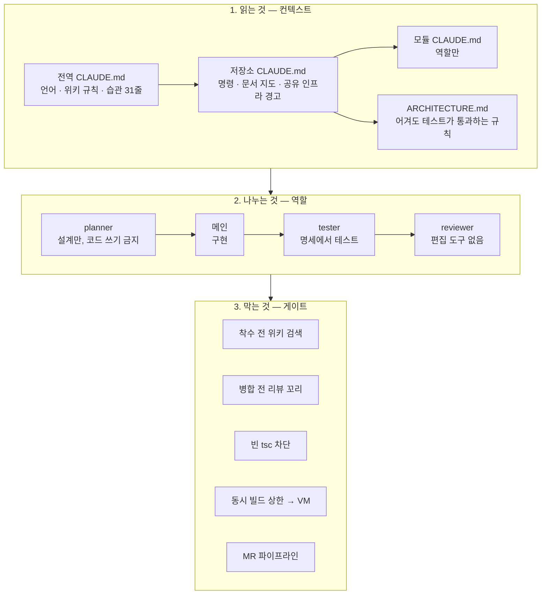
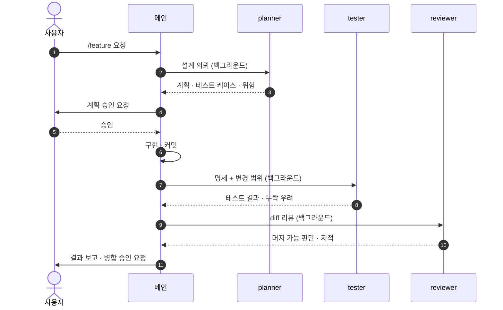
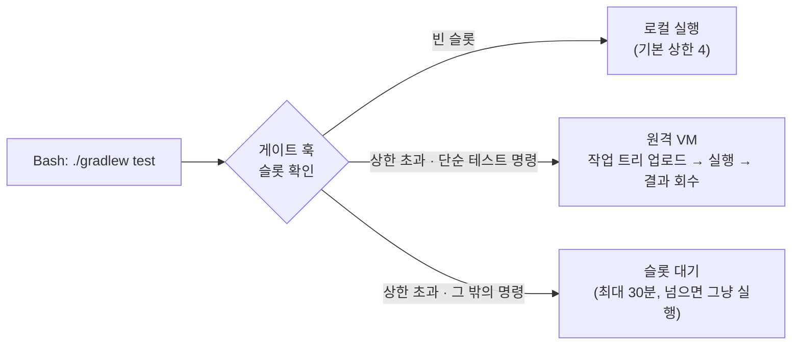

# 02. 하네스 — 에이전트가 일하는 틀

하네스는 에이전트가 무엇을 먼저 읽고, 누구에게 일을 넘기고, 어디서 멈출지를 정한 장치입니다.
구성 요소마다 실제로 겪은 실수가 계기가 됐고, 각 절에 그 이유를 함께 적었습니다.
정의 파일(에이전트·커맨드·훅)은 git으로 버전 관리합니다. 낯선 용어는 [용어집](glossary.md)에 풀어 두었습니다.

---

## 1. CLAUDE.md 계층 — 매 세션 자동으로 읽히는 문서

| 층 | 담는 것 | 담지 않는 것 |
|---|---|---|
| **전역** (약 100줄) | 응답 언어, 위키 사용 규칙, 공유 저장소 커밋 규칙, 작업 습관 한 줄 목록(승격된 규칙 31개의 결론만) | 근거와 사례. 한 줄마다 위키 노트 이름을 붙여 두고 필요할 때 펼칩니다 |
| **저장소** | 자주 쓰는 명령, 문서 지도(⭐ 코드 만지기 전에 읽을 것), 공유 개발 DB·포트 같은 공유 인프라 경고 | 파일 목록. 금방 낡기 때문입니다 |
| **모듈** (IAM 플랫폼에 10개) | 그 모듈의 역할과 경계 | 클래스·파일 인벤토리. "모듈 CLAUDE.md는 역할만" 원칙을 명문화했습니다 |
| **ARCHITECTURE.md** | 아키텍처 불변식. 기계가 잡는 규칙은 어디서 잡는지만 적고, 본론은 어겨도 테스트가 통과하는 규칙입니다([부록 A §5](appendix-a-origin.md#5-불변식-문서를-쓰는-규칙)) | 개수·현재 상태·도구 버전. 금방 거짓이 되기 때문입니다 |

#### 왜 이렇게 나눴나
- 자동 로드 문서는 매 세션의 출발점입니다. 위키나 런북에 정답이 있어도 CLAUDE.md가 반대로 적혀 있으면 에이전트는 CLAUDE.md를 따릅니다. 그래서 틀린 서술은 CLAUDE.md부터 고치고, 거기에는 실측한 사실만 적습니다(습관 규칙 「정정은 자동 로드되는 표면부터」).
- 한 번 길어진 전역 CLAUDE.md를 압축한 적이 있습니다. 근거를 다 실으면 읽는 쪽이 넘겨 읽습니다. 지금은 결론 한 줄 + 노트 이름만 남기고 근거는 위키에서 펼칩니다.

## 2. 역할 분리 — 작성자와 검토자를 나눈다

| 에이전트 | 도구 권한 | 핵심 규칙 | 산출물 |
|---|---|---|---|
| **planner** | 읽기 · 검색 · 셸 · 계획 파일 쓰기. 코드 수정 금지는 지시로 지킵니다 | 설계 전 위키 선례 회수와 점검 색인 대조가 필수입니다. 코드는 만지지 않습니다 | 목표 재진술 · 영향 파일 · 단계 · 테스트 케이스 · 위험/미정 |
| **메인** | 전부 | 구현을 맡습니다. 서브에이전트는 백그라운드로 띄우고 결과를 기다립니다(폴링 금지) | 코드 · 커밋 |
| **tester** | 읽기 · 쓰기 · 실행 | 구현자의 추론을 받지 않고 명세에서 테스트를 도출합니다. 먼저 범위 게이트로 무엇을 돌릴지 정합니다. 로컬에서는 전건을 돌리지 않고 전건은 CI에 맡깁니다 | 추가 테스트 · 실행 결과 · 누락 우려 · 통합 테스트 비용 |
| **reviewer** | 읽기 · 검색 · 셸. 편집·쓰기 도구가 없습니다 | 검토 전 의무가 넷입니다. ① 기준 트리가 통합 브랜치보다 뒤처졌는지 잰다 ② 점검 색인을 전수로 훑는다 ③ 위키 선례를 찾는다 ④ 불변식 문서와 대조한다 | 머지 가능 판단 · 정확성 · 누락 · 단순화 · 적용한 점검 |

#### 왜
- 같은 맥락에서 구현과 테스트를 함께 쓰면 구현의 오해가 테스트에 그대로 복사됩니다. tester에게 구현 코드가 아닌 명세를 주는 이유입니다.
- reviewer에게 편집 도구를 주면 "고치고 통과"로 흐릅니다. 셸은 테스트 실행과 git 조회 때문에 남겼고, 그래서 파일을 바꾸지 말라는 규칙은 지시로도 겹쳐 둡니다. 비판만 하게 해야 지적이 기록으로 남고, 그 기록이 [지식 루프](03-knowledge-loop.md)의 재료가 됩니다.
- reviewer가 기준 트리의 뒤처짐부터 재는 데에는 계기가 있습니다. 538커밋 뒤처진 워크트리에서 이미 해결된 문제를 미해결로 지적한 적이 있습니다.

## 3. 파이프라인 — 슬래시 커맨드로 고정한 순서

| 커맨드 | 순서 | 사람이 끼는 곳 |
|---|---|---|
| `/feature` | planner → 구현 → tester → reviewer | 계획 승인, 병합 승인 |
| `/bugfix` | 위키 선례 → 원인 위치 탐색 → 재현 → 점검 색인 대조·수정 → 회귀·인접 케이스 테스트 → 리뷰 | 원인 확인, 병합 승인 |
| `/perf-verify` | 베이스라인 측정 → 튜닝 → 재측정 → 영향 모듈 회귀 → 리뷰 (동시성 변경이면 그 관점 우선) | 판정 |
| `/review-mine` | 현재 diff를 reviewer에게 넘기는 셀프 리뷰 | — |

성능 비교는 같은 머신의 벽시계로 판정하지 않습니다. SQL 문 수·호출 수 같은 결정적 값으로 판정합니다. 여러 세션이 한 머신을 같이 쓰기 때문에 시간은 부하에 묻힙니다.

## 4. PreToolUse 게이트 — 규칙이 안 지켜지는 자리에서 기계로 막는다

야간 세션 감사([03 지식 루프](03-knowledge-loop.md))는 위반을 다음 날 셉니다. 감사에서 가장 많이 걸린 두 규칙은 2026-10-21에, 실제로 통합 브랜치 빌드를 깨뜨린 검사 하나는 2026-11-05에 도구 호출 직전에 막는 전역 훅으로 내렸습니다.

| 게이트 | 언제 걸리나 | 무엇을 보나 | 우회 |
|---|---|---|---|
| **병합 전 리뷰 꼬리** | 통합 브랜치(dev·main 등)로의 `git merge` | 세션 기록에서 마지막 리뷰 호출을 찾습니다. 그 뒤 커밋이 문서·주석뿐이 아니면 막습니다 | 명령 앞 환경 변수. 쓰면 사용자에게 알립니다 |
| **착수 전 위키 검색** | 세션의 첫 편집·커밋 | 그 전에 위키 검색이 없으면 세션당 한 번 막습니다. 서브에이전트의 검색도 검색으로 칩니다 | 검색할 것이 정말 없으면 그대로 다시 실행 |
| **빈 tsc 차단** | `tsc`·`vue-tsc` 실행 | 읽을 tsconfig가 입력 없이 references만 있으면 막습니다. 검사 대상이 0개라 틀린 코드에도 rc=0이 나옵니다 | 명령 앞 환경 변수 |

#### 설계 원칙
- 실패는 연다(fail-open). 이 훅은 머신의 모든 세션에 걸립니다. 예외·모르는 저장소·시간 초과는 전부 통과시키고, 통과 사유를 로그 파일에 남깁니다. 게이트가 고장 나도 아무도 모르는 상황을 막기 위해 야간 감사가 그 로그를 사유별로 셉니다.
- 저장소 git 훅이 아니라 전역 훅을 고른 이유: 저장소 훅은 한 저장소에만 있었습니다. 위반이 나온 세션 25개 중 11개만 덮었습니다. 전역 훅은 저장소와 무관하게 도구 호출 직전에 걸리고, 세션 기록 경로를 입력으로 받아 "마지막 리뷰"를 판정할 수 있습니다.
- 셸을 흉내 내지 않습니다. 값을 모르는 인자·명령 치환·복합문은 판정하지 않고 통과시킨 뒤 로그에 남깁니다. 줄여 새로 쓴 [예시 훅](../examples/hooks/review_gate.py)의 머리 주석에 못 보는 것과 잘못 막는 것을 나열해 두었습니다.
- 이 절의 게이트 셋은 모든 세션에 걸리는 전역 훅입니다. 저장소 안에도 막는 장치가 따로 있습니다. 공유 DB 대조 기동 게이트([사례 1](01-case-studies.md#1-공유-개발-db에-적용된-마이그레이션이-다른-워크트리의-기동을-깨뜨렸다)), 테스트 0건이면 실패하는 빌드 가드([사례 2](01-case-studies.md#2-캐시에서-복원된-결과를-테스트-통과로-보고했다)) 같은 것들입니다.
- 게이트 3종, 빌드 슬롯, 감사 판정 코드에 테스트 함수 159개가 붙어 있습니다([`data/wiki_harness.csv`](../data/wiki_harness.csv)).

## 5. 동시 빌드 상한과 VM 테스트 분산

한 머신에서 세션 열 개 안팎이 동시에 Gradle 빌드를 돌리다 메모리가 바닥났습니다(실측: 24 GB 중 18.6 GB 점유, 스왑 거의 소진, 10코어에서 부하 33~50).
Gradle에는 머신 전체의 동시 빌드 상한 설정이 없습니다. `workers.max` 같은 옵션은 빌드 하나 안에서만 적용됩니다.

- 데몬이 뜨기 전, 명령 앞에서 막습니다. 데몬 안(init 스크립트)에서 기다리면 그 데몬이 BUSY로 남아 다음 빌드가 데몬을 또 띄웁니다.
- 슬롯은 파일 잠금(`flock`)입니다. 쥔 프로세스가 죽으면 커널이 풀기 때문에 강제 종료해도 슬롯이 새지 않습니다.
- VM으로 보내는 명령은 테스트 명령의 좁은 모양뿐입니다. 컴파일·패키징을 원격에서 돌리면 결과물이 원격에만 남아, 다음 명령이 로컬의 낡은 결과를 읽습니다. 테스트 결과 파일은 끝나면 로컬로 받아 덮어씁니다. 안 받으면 낡은 통과 결과를 읽기 때문입니다.
- VM은 8 GB이고 동시 1개입니다. 통합 테스트 1건의 최고 사용량이 4.4 GB였습니다.

## 6. MR 파이프라인 게이트 (CI)

에이전트가 로컬에서 고른 "영향 범위 테스트"는 전건이 아닙니다. 전건은 CI가 맡습니다.

| 단계 | 하는 일 | 설계상 지키는 것 |
|---|---|---|
| **scope** | base 커밋 대비 변경 경로로 무거운 검증이 필요한지 판정 | 판정 불능이면 전부 실행(fail-safe). 변수 전달이 깨져 빈 값이 와도 검증을 돌립니다 |
| **verify** | 문서 표류 검사(문서가 인용한 코드·화면 문구가 실재하는지), 런북 인용 표류, 개발 스크립트 테스트, 백엔드·프런트엔드·모듈별 테스트 | 경로 게이트는 job을 안 만드는 방식이 아니라 job 안에서 건너뛰고 로그를 남기는 방식입니다. 무엇이 왜 안 돌았는지 화면에 보여야 합니다 |
| **integration** | 실제 DB 컨테이너로 통합/E2E. 정기 실행 또는 수동 트리거, 2개 샤드 | `--rerun-tasks --no-build-cache`로 캐시에서 복원된 통과를 막고, 끝나면 SKIP 0건인지 검사합니다 |

변경 경로 판정과 문서 표류 검사는 비교 기준 커밋을 git으로 읽어야 합니다. 이력을 일부만 받아 오면 기준 커밋이 없어 검사가 아무것도 걸러내지 못하므로, CI에서도 전체 이력을 받습니다.

---

### 이 구조에서 사람이 하는 일

계획 승인과 병합 승인은 사람이 합니다. 우회 환경 변수를 쓰면 그 사실을 사람에게 알립니다. 그리고 감사 후보 가운데 진짜 위반인지 판정하는 일도 사람 몫입니다(→ [05 배운 것](05-lessons.md)).
