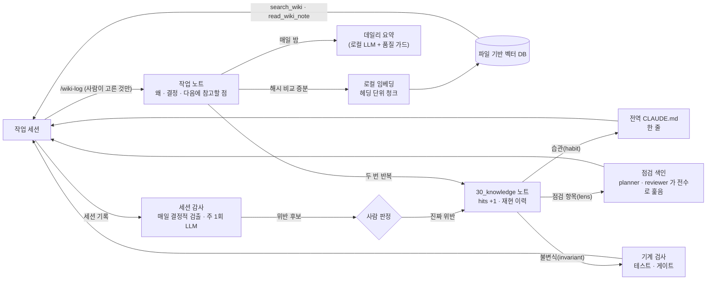
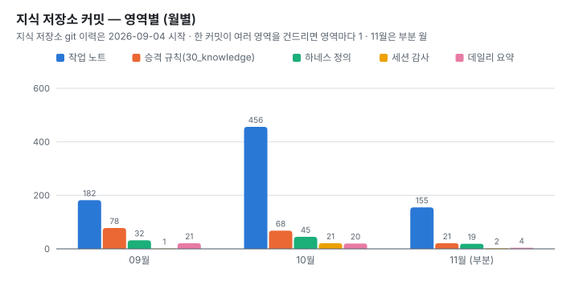

# 03. 지식 루프 — 같은 실수를 두 번째에서 멈추게 하는 장치

에이전트는 세션이 끝나면 기억을 잃습니다. 사람도 몇 달 전에 왜 그렇게 정했는지 기억하지 못합니다.
그래서 "무엇을 했나"가 아니라 "왜 그렇게 결정했나"를 남기고, 다음 세션이 그것을 검색해서 쓰게 하는 루프를 만들었습니다.
노트 저장·임베딩·검색·야간 요약은 로컬에서 돕니다. 바깥으로 나가는 것은 둘입니다. 에이전트가 검색 결과로 읽은 노트 조각은 클라우드 모델인 에이전트의 맥락에 들어가고, 주간 감사는 가림 처리한 세션 기록을 클라우드 모델에 보냅니다.

## 1. 캡처 — 사람이 고른다

- `/wiki-log` 커맨드가 git 상태·커밋·diff를 모아 노트 초안을 씁니다. 노트의 중심 절은 「왜 / 결정 사항」과 「다음에 참고할 점」입니다.
- 캡처는 항상 사람이 시킵니다. 자동 캡처는 노이즈를 쌓아 검색 품질을 떨어뜨립니다.
- 저장 직후 재인덱싱하고 그 자리에서 커밋합니다. 지식 저장소는 모든 세션이 동시에 쓰는 공유 저장소라, 커밋하지 않고 둔 동안 다른 세션의 커밋에 섞일 수 있습니다([사례 3](01-case-studies.md#3-공유-저장소에서-git-add--a-가-다른-세션의-작업을-쓸어-담았다)).

## 2. 회상 — 로컬 RAG

| 구성 | 선택 | 이유 |
|---|---|---|
| 저장소 | Obsidian vault (순수 마크다운 + git) | 사람이 그대로 읽고 링크로 탐색할 수 있습니다 |
| 임베딩 | EmbeddingGemma 300M(4비트), MLX 런타임(Apple Silicon) | 한국어 노트가 대부분입니다. 노트 전체를 외부 임베딩 서비스로 보내지 않고, 비용도 들지 않게 하려고 로컬을 골랐습니다. 검색 결과로 고른 일부 조각은 에이전트의 맥락으로 들어갑니다 |
| 청크 | `##` 헤딩 단위, 긴 절은 약 1,100자로 분할 | 노트 형식이 절 단위로 의미가 닫혀 있습니다 |
| 인덱싱 | SHA-256 해시 비교로 바뀐 노트만 재임베딩 | 노트가 천 건을 넘어도 저장 직후 반영됩니다 |
| 제공 | MCP 서버 하나를 상시 데몬으로 (`search_wiki(query, k, project)`, `read_wiki_note(path)`) | 모든 세션이 임베더 하나를 공유합니다. 세션마다 모델을 띄우지 않습니다 |

"예전에 / 지난번에 어떻게 했지" 같은 회상성 질문이 오면 먼저 검색하라는 규칙을 전역 CLAUDE.md에 두었습니다. 첫 편집 전에 검색했는지는 게이트가 확인합니다([02 하네스 §4](02-harness.md#4-pretooluse-게이트--규칙이-안-지켜지는-자리에서-기계로-막는다)).

## 3. 데일리 요약 — 로컬 LLM에도 가드가 필요했다

매일 밤 스케줄러가 그날 노트를 로컬 소형 LLM으로 요약합니다(누적 105일치).
- 처음에는 요약 7건이 망가졌습니다. 반복 축퇴 4건, 형식 붕괴 3건입니다. 확인된 원인에는 greedy 디코딩, 그리고 본문의 `##` 제목이 출력 형식을 오염시킨 것이 있었습니다.
- 처방
  - 본문 대신 340자 다이제스트를 입력으로 넣습니다.
  - 샘플링 파라미터를 조정했습니다.
  - 생성물 검사기를 붙였습니다. 반복과 형식 이탈을 반려하고, 두 번 실패하면 모델 없이 추출식으로 씁니다.
  - 망가진 원본은 회귀 표본으로 남겼습니다.
- 「다음에 할 일」 절은 모델을 거치지 않고 각 노트의 「다음에 참고할 점」을 원문 그대로 뽑아 붙입니다. 모델에 맡기면 원문을 베끼거나 일반론으로 흐렸습니다.

## 4. 세션 감사 — 규칙 위반을 다음 날 센다

| 주기 | 방식 | 대상 |
|---|---|---|
| 매일 | 결정적 검출(정규식·세션 기록 파싱) | 리뷰 없이 통합 브랜치로 병합한 경우, 첫 편집·커밋이 첫 위키 검색보다 앞선 경우, 게이트 통과 로그의 사유별 집계 |
| 주 1회 | LLM 감사. 가림 처리한 세션 기록을 클라우드 모델에 보냅니다. 에이전트 작업과 별도로 외부에 보내는 유일한 경로입니다 | 결정적 검출이 못 보는 습관 위반, 하네스 정의 자체의 결함 후보 |

감사 결과는 전부 후보입니다. 진짜 위반으로 셀지는 사람이 판정 절차를 따라 정합니다.
- 세션 날짜와 규칙 날짜를 맞춥니다. 규칙이 생기기 전 세션이면 세지 않습니다.
- 위반은 세션 단위로 셉니다. 노트의 「재현 이력」에 세션 ID 앞 8자리를 남겨 중복을 거릅니다.
- 포크·재개된 세션은 부모 기록을 통째로 복사해 시작합니다. 그래서 부모 구간의 사건은 부모 것으로 칩니다.
- 게이트가 켜진 뒤에는 게이트가 막은 것을 세지 않습니다. 막은 것은 가드가 동작한 증거이고, 게이트를 빠져나간 것만 위반으로 셉니다.

`hits` 는 같은 실수가 발생한 횟수의 하한입니다. 승격 전의 첫 발생도 포함하고, 모호하면 세지 않습니다. 이 문서에서는 "발생 기록"이라고 부릅니다.

## 5. 승격 — 같은 실수가 두 번 나면 규칙이 된다

같은 실수가 두 번째로 나면 그 교훈을 `30_knowledge/` 노트로 승격합니다. 노트 frontmatter가 그 규칙의 종류와 집행 상태를 말합니다.

| kind | 뜻 | 집행 | 노트 수 | 발생 기록 합(하한) |
|---|---|---|---:|---:|
| **habit** | 에이전트 자신의 작업 절차. CI로 내려보낼 수 없습니다 | 전역 CLAUDE.md 한 줄. 일부는 게이트로 | 31 | 166 |
| **lens** | 사람이나 모델이 diff를 읽어야 성립하는 점검 | 점검 색인. planner·reviewer가 매번 전수로 훑습니다 | 54 | 166 |
| **invariant** | 기계 검사로 내려보낼 수 있는 규칙 | 테스트·검사 스크립트. 검사 파일이 실존하는지 매일 확인합니다 | 5 | 19 |
| reference | 교훈이 아닌 참고 대장 | — | 1 | 0 |

> 출처: [`data/wiki_knowledge_kinds.csv`](../data/wiki_knowledge_kinds.csv). 노트마다 기록된 `hits` 의 합이고, 기록이 없는 노트는 0으로 셌습니다.

#### 운영 규칙 몇 가지
- `check`는 150자 이하로 씁니다. 색인 한 줄을 매번 전수로 훑기 때문에 길어지면 넘겨 읽힙니다. 같은 실수가 다시 나면 문장을 늘리지 않고 `hits` 숫자를 올립니다. 문장을 덧붙였더니 발생 기록이 많은 노트일수록 덜 읽히는 역전이 실제로 일어났기 때문입니다.
- `mechanize` 에는 기계화 결정을 남깁니다. 실제 검사의 경로이거나, 못 내리는 이유("불가 — …", "보류 — …")입니다. 비어 있으면 아직 아무도 판단하지 않은 것이라 연체 목록에 오릅니다.
- `guards` 는 검사 파일의 위치입니다. 다른 저장소의 검사가 지워져도(실제로 CI 이전 때 지워졌습니다) 노트는 한 글자도 안 바뀝니다. 그래서 그 파일이 통합 브랜치에 실존하는지를 매일 잽니다. 실존이 집행을 뜻하지는 않는다는 한계도 적어 두었습니다.
- 습관(habit) 31개의 기계화 상태는 이렇습니다(노트 frontmatter 기준).
  - 기계화 5
  - 불가 14
  - 보류 6
  - 부분 1
  - 미기록 5

  노트를 갱신하지 않아 이 수에 아직 안 잡힌 장치도 있습니다(예: [사례 1](01-case-studies.md)의 기동 게이트).

## 6. 용어 사전 — 은어도 검사한다

노트가 1,000건 가까이 쌓이자 새 세션이 노트를 읽는 비용이 커졌습니다. 재 보니 문제는 길이가 아니었습니다.
- 노트에서 "무엇을 했나" 절은 평균 286자로 이미 짧았습니다. 긴 것은 "왜 / 결정 사항" 절(평균 2,055자)인데, 이 위키의 목적 자체라 줄일 대상이 아니었습니다.
- 대신 정의 없이 퍼진 은어가 많았습니다. "실측"은 295개 노트에, "게이트"는 210개, "가드"는 196개 노트에 나왔습니다.

그래서 요약을 늘리는 대신 2026-09-29에 용어 사전을 만들었습니다.
- 노트 약 580개를 100개씩 나눠 에이전트 6개에 맡기고, 본문의 실제 쓰임에서 정의를 뽑았습니다.
- 작업 방식 용어를 담은 공통 사전 하나(36개로 시작해 지금 41개)와 제품 도메인 사전 둘을 만들었습니다. 이 포트폴리오의 [용어집](glossary.md)은 공통 사전을 바탕으로 다시 썼습니다.
- 항목은 한 줄 정의, 그 용어가 실제로 쓰인 대표 노트, 쓰지 않을 동의어로 이루어집니다.

사전도 검사기와 한 세트로 만들었습니다. 손으로 관리하는 목록은 조용히 낡기 때문입니다. 검사기가 보는 것은 셋입니다.
1. 항목 형식이 맞는가
2. 대표 노트가 아직 있고, 본문에 그 용어가 실제로 있는가. 노트가 지워지거나 이름이 바뀌어 인용이 끊긴 것도 여기서 잡힙니다
3. 커밋이 새로 추가한 줄에 쓰지 않기로 한 표기가 있는가. 커밋 후 훅이 알립니다

3번을 파일 전체가 아니라 추가된 줄로 한정한 데는 이유가 있습니다. 옛 노트를 조금만 고쳐도 그 노트의 옛 표기가 전부 경고로 뜨면, "기존 노트 본문은 고치지 않는다"는 원칙과 부딪힙니다.
표기는 실제 쓰임에 따라 바꾸기도 했습니다. 예를 들어 2026-11-06에 "가짜 초록"을 버리고 "거짓 초록"을 정본으로 삼았습니다. 그 사이 새로 쓴 줄에서 "거짓 초록"이 14번, "가짜 초록"이 4번 쓰였기 때문입니다.

못 하는 것도 재서 적어 두었습니다. 사전에 없는 새 은어는 기계로 찾지 못합니다. 노트 10개 이상에 나오는 대문자 약어 197개를 뽑아 보니 대부분이 일반어나 코드 상수였고, 한국어 조어는 빈도로 일반어와 갈리지 않았습니다. 그래서 새 은어가 노트 두 개 이상에 쓰이면 노트를 캡처할 때 사람이 한 줄 추가합니다.

검사기를 만들면서 검사기 자신이 조용히 항목을 빠뜨리는 경로를 리뷰 세 번에 걸쳐 찾았습니다. 본문의 가로줄(`---`)이 머리말 판정을 뒤집어 그 아래 항목이 전부 빠졌고, 영문 약어를 부분 문자열로 찾다가 엉뚱한 단어 안에서 맞아 대조가 공허해졌습니다. 검사기에는 지금 테스트 함수 12개가 붙어 있습니다.

## 7. 규모

| 항목 (스냅샷 2026-11-07) | 값 | 출처 |
|---|---:|---|
| 작업 노트 | 1,065 | [`wiki_notes_by_month.csv`](../data/wiki_notes_by_month.csv) — frontmatter `date` 기준. 제품 3종 밖의 작업도 포함합니다 |
| 규칙 노트 (`30_knowledge`) | 91 (참고용 1 포함) | [`wiki_knowledge_kinds.csv`](../data/wiki_knowledge_kinds.csv) |
| 데일리 요약 | 105 | [`wiki_harness.csv`](../data/wiki_harness.csv) |
| 에이전트 / 커맨드 정의 | 4 / 7 | 같은 파일. 에이전트는 planner·tester·reviewer와 화면 디자인 구현 전용 1개, 커맨드는 개발 파이프라인 4개(`/feature`·`/bugfix`·`/perf-verify`·`/review-mine`)와 VM 테스트 1개, 위키 2개(`/wiki-log`·`/wiki-daily`) |
| 지식 저장소 커밋 (2026-09-04 이후) | 1,032 | [`wiki_summary.csv`](../data/wiki_summary.csv) — 지식 저장소의 git 이력은 이날 시작합니다 |

<picture>
  <source media="(prefers-color-scheme: dark)" srcset="../assets/charts/wiki-areas-dark.svg">
  
</picture>

작업 노트는 월별로 58 → 94 → 160 → 256 → 383건(6~10월)으로 늘었고, 11월은 6일까지 114건입니다. 제품이 하나에서 셋으로 늘어난 시기와 겹칩니다.
