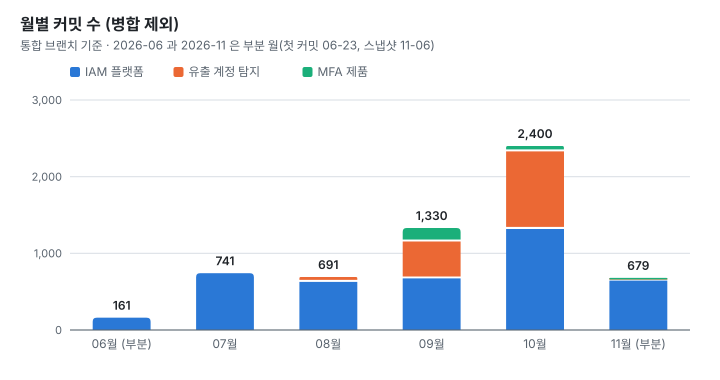
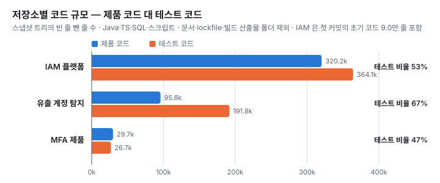
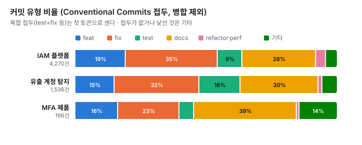
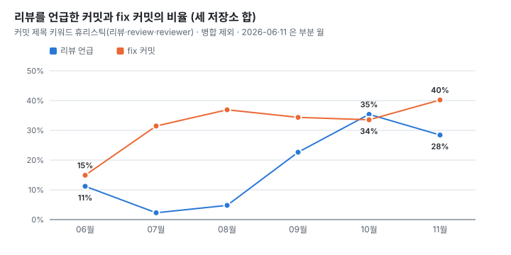

# 06. 지표 — git 이력에서 뽑은 것만

모든 차트와 표는 [`scripts/collect.py`](../scripts/collect.py)가 git 이력에서 집계한 [`data/*.csv`](../data)를 [`scripts/charts.py`](../scripts/charts.py)로 그린 것입니다.
지표의 정의와 재현 명령은 [`data/README.md`](../data/README.md)에 있습니다.

- 스냅샷: 제품 저장소 3개는 각 통합 브랜치의 2026-11-06 시점 커밋에 고정했습니다. 지식 저장소는 2026-11-07 시점에 고정했습니다. 통합 브랜치가 계속 움직이므로, 고정하지 않으면 같은 명령이 다른 수를 냅니다.
- 병합 커밋은 뺐습니다. IAM 플랫폼 통합 브랜치에서 닿는 커밋 6,763개 중 2,493개가 병합 커밋입니다. 넣으면 숫자가 1.6배로 부풉니다. 이 2,493개에는 기능 브랜치 안에서 생긴 병합도 들어 있습니다. 통합 브랜치에 직접 들어온 병합(`--first-parent`)만 세면 1,341개입니다.
- 2026-06과 2026-11은 부분 월입니다.

## 1. 월별 커밋 수

<picture>
  <source media="(prefers-color-scheme: dark)" srcset="../assets/charts/monthly-commits-dark.svg">
  
</picture>

| 월 | IAM 플랫폼 | 유출 계정 탐지 | MFA 제품 | 합 |
|---|---:|---:|---:|---:|
| 2026-06 (부분) | 161 | — | — | 161 |
| 2026-07 | 741 | — | — | 741 |
| 2026-08 | 654 | 37 | — | 691 |
| 2026-09 | 699 | 482 | 149 | 1,330 |
| 2026-10 | 1,344 | 1,011 | 45 | 2,400 |
| 2026-11 (부분) | 671 | 6 | 2 | 679 |
| **합** | 4,270 | 1,536 | 196 | 6,002 |

해석
- 9~10월에 저장소가 셋으로 늘었는데 IAM 플랫폼의 월 커밋은 줄지 않았습니다. 10월에는 오히려 두 배가 됐습니다.
- 한 사람이 여러 세션을 동시에 돌린 결과로 봅니다. 이것은 [02 하네스](02-harness.md)의 동시 빌드 상한과 공유 자원 규칙이 생긴 배경이기도 합니다.
- 커밋 수는 작업 단위의 개수이지 생산성 지표가 아닙니다. 이 하네스는 작은 커밋과 리뷰 반영 커밋을 장려합니다.

## 2. 코드 규모 — 제품 코드 대 테스트 코드

<picture>
  <source media="(prefers-color-scheme: dark)" srcset="../assets/charts/code-scale-dark.svg">
  
</picture>

| 저장소 | 제품 코드 | 테스트 코드 | 테스트 비율 |
|---|---:|---:|---:|
| IAM 플랫폼 | 320,222 | 364,084 | 53% |
| 유출 계정 탐지 | 95,846 | 191,826 | 67% |
| MFA 제품 | 29,701 | 26,687 | 47% |
| **합** | 445,769 | 582,597 | 56.7% |

- 빈 줄을 뺀 줄 수입니다. 대상 확장자는 Java·Kotlin·Groovy·Gradle·TS/JS·Vue·CSS·SQL·Python·셸입니다.
- 문서(`.md`), lockfile, Gradle wrapper, 빌드 산출물 폴더(`build/`·`dist/` 등), 고객 산출물 폴더는 뺐습니다. 저장소에 커밋된 생성 코드나 대용량 시드 SQL은 그대로 셉니다.
- IAM 플랫폼은 첫 커밋에 들어온 초기 코드가 포함돼 있습니다. 제품 코드 6.2만 줄과 테스트 코드 2.8만 줄, 합해서 9.0만 줄입니다([`baseline_lines.csv`](../data/baseline_lines.csv)). 나머지 두 제품의 첫 커밋은 100줄 안팎입니다.
- "테스트 코드"는 경로로 판정합니다. 정확한 패턴은 [`data/README.md`](../data/README.md)에 있습니다.
- 줄 수가 많다고 좋은 코드는 아닙니다. 에이전트가 만든 테스트 코드는 쉽게 늘어나므로, 테스트 코드 비율만으로 테스트 품질이나 tester 구조의 효과를 말할 수는 없습니다. 문서 줄 수(별도 집계 8.7만 줄)는 [`code_lines.csv`](../data/code_lines.csv)에 있습니다.

## 3. 커밋 유형

<picture>
  <source media="(prefers-color-scheme: dark)" srcset="../assets/charts/commit-types-dark.svg">
  
</picture>

- Conventional Commits 접두로 분류했습니다. `test+fix`, `fix(ci),test` 같은 복합 접두는 첫 토큰으로 셉니다.
- 세 저장소 모두 fix가 feat보다 많습니다. docs는 28~39%입니다.
  - fix가 많은 이유는 리뷰·테스트 지적의 반영을 별도 커밋으로 남기기 때문으로 봅니다.
  - docs가 많은 이유는 설계 문서·런북·CLAUDE.md를 코드와 같은 저장소에서 같이 고치기 때문입니다. 이 문서들이 에이전트가 다음 세션에서 읽는 입력이 됩니다.

## 4. 리뷰를 언급한 커밋의 비율

<picture>
  <source media="(prefers-color-scheme: dark)" srcset="../assets/charts/review-share-dark.svg">
  
</picture>

| 월 | 커밋 | 리뷰 언급 | fix | tester 언급 |
|---|---:|---:|---:|---:|
| 2026-06 (부분) | 161 | 18 (11%) | 24 (15%) | 0 |
| 2026-07 | 741 | 17 (2%) | 233 (31%) | 0 |
| 2026-08 | 691 | 33 (5%) | 255 (37%) | 4 |
| 2026-09 | 1,330 | 301 (23%) | 457 (34%) | 43 |
| 2026-10 | 2,400 | 849 (35%) | 805 (34%) | 88 |
| 2026-11 (부분) | 679 | 193 (28%) | 273 (40%) | 0 |

- 커밋 제목에 `리뷰`·`review`·`reviewer` 가 있으면 "리뷰 언급"으로 셉니다(휴리스틱). 리뷰를 했어도 제목에 안 적었으면 빠지고, 리뷰와 무관하게 단어만 들어간 커밋은 포함됩니다.
- 리뷰 언급은 8월 5%에서 10월 35%로 올랐습니다. 리뷰어 위임 규칙의 승격(08-28), 세션 감사(9월 말), 병합 게이트(10-21)가 이 사이에 차례로 들어왔습니다. 다만 커밋 메시지 관행의 변화가 섞여 있어 인과로 보지는 않습니다.

## 5. 통합 병합 메시지에 리뷰 단어가 든 비율 (IAM 플랫폼)

표와 차트, 해석은 [사례 4](01-case-studies.md#4-리뷰-없이-통합-브랜치에-병합했다--규칙에서-게이트로)에 있습니다. 나머지 두 저장소는 병합 대신 직접 커밋하는 흐름이라 병합이 1~3건뿐이어서 이 지표를 그리지 않았습니다.

## 6. AI 공동 작성 트레일러

| 저장소 | 커밋 | `Co-Authored-By: Claude…` 트레일러 | 비율 |
|---|---:|---:|---:|
| IAM 플랫폼 | 4,270 | 4,054 | 94.9% |
| 유출 계정 탐지 | 1,536 | 1,528 | 99.5% |
| MFA 제품 | 196 | 196 | 100% |

- 이 숫자는 에이전트가 커밋을 만든 비율에 가깝고, 코드의 저자 비중이 아닙니다.
- 설계 판단과 승인, 그리고 무엇을 만들지는 사람이 정했습니다([05 배운 것](05-lessons.md)).

